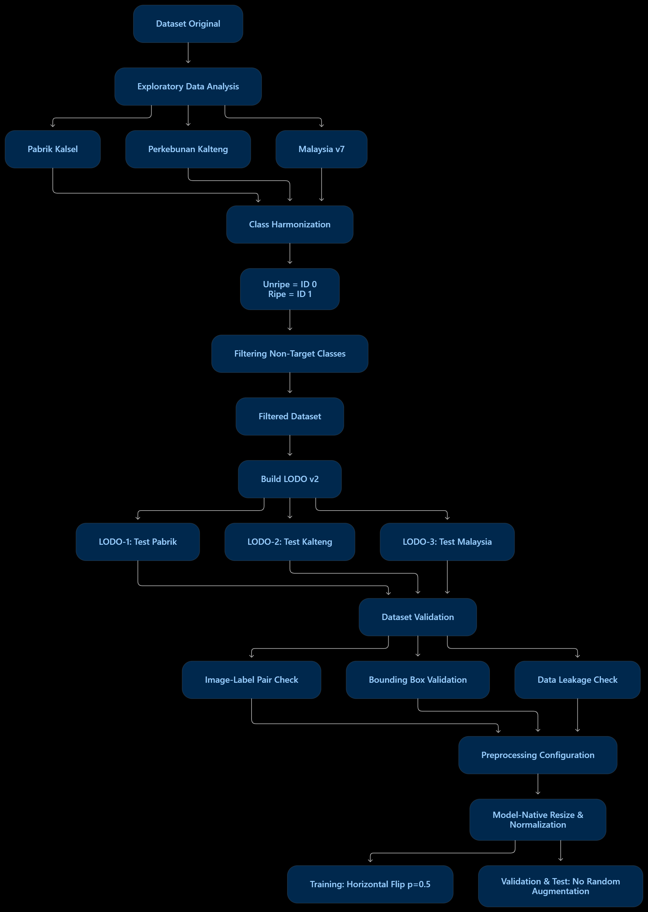

## Diagram Alur Preprocessing

Gambar berikut menunjukkan tahapan pengolahan dataset mulai dari
dataset original, EDA, harmonisasi kelas, filtering, pembangunan
LODO v2, hingga konfigurasi preprocessing model.

## Keterangan

1. Dataset dari tiga domain diperiksa melalui EDA.
2. Kelas diselaraskan menjadi Unripe dan Ripe.
3. Kelas non-target dikeluarkan dari dataset benchmark.
4. Dataset disusun menjadi tiga skenario Leave-One-Dataset-Out.
5. Validasi dilakukan terhadap pasangan gambar-label,
   bounding box, dan potensi kebocoran data.
6. Resize dan normalisasi mengikuti pipeline masing-masing model.
7. Horizontal flip direncanakan hanya untuk data training.
